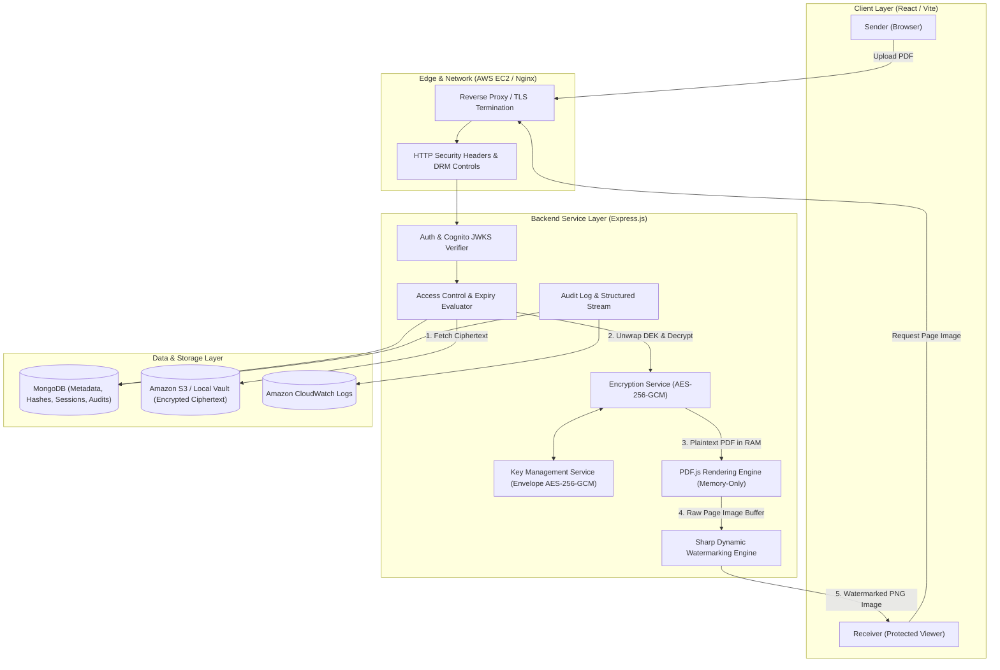

# SecureShare — System Architecture & Cloud Design

## 1. Executive Architecture Overview

SecureShare is an enterprise-grade document sharing platform engineered to demonstrate genuine authenticated encryption, zero-trust recipient access control, and dynamic leak-attribution watermarking.

The core design principle is **Zero Client Plaintext Retention**: receivers interact with multi-page documents strictly through a specialized protected viewer that requests watermarked raster images on-demand. Plaintext PDF binaries are never transmitted to the browser, cached on permanent server disk, or stored in public storage.



---

## 2. Component Hierarchy

### 2.1 Frontend Architecture (`client/`)
Built with React, Vite, and Tailwind CSS using a cyber defense aesthetic:
- **`src/contexts/AuthContext.jsx`**: Manages user authentication tokens (Cognito or Local JWT) and user profile state.
- **`src/pages/Landing.jsx`**: Public showcase detailing cryptographic protocols and features.
- **`src/pages/Dashboard.jsx`**: Sender management portal showing encrypted document metrics, upload controls, and quick share actions.
- **`src/pages/Documents.jsx`**: Full document vault with AES-256-GCM encryption badges, search, and deletion.
- **`src/pages/ShareManagement.jsx`**: Real-time link monitor with expiry countdowns, view counters, and instant revocation killswitch.
- **`src/pages/ProtectedViewer.jsx`**: The secure DRM viewer. Renders server-composited watermarked page images, disables context menus and print shortcuts, and provides zoom and page navigation.
- **`src/pages/AccessDenied.jsx`**: Granular security denial screen (Expired, Revoked, Unauthorized Recipient, Limit Reached).
- **`src/pages/Activity.jsx`**: Live audit feed displaying real-time security events.

### 2.2 Backend Architecture (`server/`)
Constructed with Express.js following strict separation of concerns:
- **`src/config/`**:
  * `env.js`: Strict validation of cryptographic master keys, storage modes, and AWS configurations.
  * `db.js`: Resilient MongoDB connection pooling and graceful disconnection.
- **`src/services/`**:
  * `keyManagementService.js`: Master key wrapping and unwrapping of per-document DEKs using AES-256-GCM.
  * `encryptionService.js`: High-performance AES-256-GCM document encryption with fresh 96-bit nonces.
  * `s3StorageService.js`: Dual-mode storage client (Amazon S3 bucket or local encrypted vault).
  * `shareService.js`: Cryptographically secure 32-byte token generation (`crypto.randomBytes(32)`) and SHA-256 hashing.
  * `accessControlService.js`: Zero-trust validation of tokens, recipient email policies, UTC expiration, and view sessions.
  * `pdfRenderingService.js`: In-memory PDF structure validation, page count extraction, and high-DPI rasterization via PDF.js and Canvas.
  * `watermarkService.js`: Server-side diagonal SVG watermark compositing via Sharp, embedding verified identities.
  * `auditService.js`: Persistent security logging to MongoDB and streaming to Amazon CloudWatch.
- **`src/middleware/`**:
  * `authMiddleware.js`: AWS Cognito JWKS verification and local JWT fallback.
  * `uploadMiddleware.js`: In-memory Multer storage with strict PDF MIME and size checks.
  * `rateLimiter.js`: Brute-force protection for authentication and page streaming.
  * `errorHandler.js`: Safe centralized error handling preventing secret leakage.

---

## 3. Cryptographic Data Flow

### 3.1 Document Upload & Encryption
```text
1. Sender uploads original PDF -> Multer holds binary in RAM buffer.
2. PdfRenderingService inspects magic bytes (%PDF) and extracts total page count.
3. EncryptionService generates a fresh 32-byte Data Encryption Key (DEK).
4. EncryptionService generates a fresh 12-byte initialization vector (nonce).
5. File buffer is encrypted using AES-256-GCM -> Produces ciphertext and 16-byte AuthTag.
6. KeyManagementService wraps DEK using AES-256-GCM with the Master Key.
7. Random storage key is generated: doc_<uuid>.enc.
8. Ciphertext is uploaded to private S3 bucket / local vault.
9. Metadata, wrapped DEK, nonce, and authTag stored in MongoDB.
10. Raw DEK and plaintext buffer in memory are zeroized (filled with zeros).
```

### 3.2 Secure Share Creation
```text
1. Sender specifies recipient email, expiry hours, and optional max session limit.
2. ShareService generates 32 random bytes -> Base64url token.
3. ShareService calculates SHA-256 hash of the token.
4. Only the SHA-256 hash is saved to MongoDB (tokenHash).
5. Raw token is returned ONCE to sender and never recorded in logs or database.
```

### 3.3 Protected Viewing Pipeline
```text
1. Receiver opens /view/:rawToken in browser.
2. Receiver authenticates with Cognito / platform credentials.
3. Receiver requests page N with Authorization token.
4. AccessControlService computes SHA-256(rawToken) and looks up Share record.
5. Strict checks:
   a. Share exists?
   b. Revocation timestamp is null?
   c. Current UTC time < expiresAt?
   d. Authenticated user email matches share.recipientEmail?
   e. Page number is within [1, pageCount]?
   f. Session limits satisfied?
6. S3StorageService fetches ciphertext from private storage.
7. KeyManagementService unwraps DEK using Master Key.
8. EncryptionService decrypts ciphertext and verifies 16-byte AuthTag.
9. PdfRenderingService rasterizes Page N to a raw PNG image buffer in RAM.
10. Plaintext PDF buffer is immediately zeroized and freed.
11. WatermarkService composites dynamic diagonal watermark with:
    - Verified Sender Identity
    - Verified Recipient Identity
    - "CONFIDENTIAL" Label
    - Timestamp & Session ID
12. Watermarked PNG image sent with headers:
    Cache-Control: no-store, private
    Referrer-Policy: no-referrer
    X-Content-Type-Options: nosniff
13. AuditService logs PAGE_RENDERED event.
```

---

## 4. AWS Cloud Services Integration

SecureShare integrates four core AWS services using `@aws-sdk/client-s3`, `@aws-sdk/client-cloudwatch-logs`, and `aws-jwt-verify`:

| AWS Service | Role in SecureShare | Security Configuration |
| :--- | :--- | :--- |
| **Amazon EC2** | Application Host | Ubuntu LTS, Node.js runtime, PM2 process manager, Nginx reverse proxy with TLS 1.3, IAM Instance Role. |
| **Amazon S3** | Encrypted Object Vault | Private bucket with Public Access Block enabled. Server-side SSE-S3/KMS encryption on top of application AES-GCM. |
| **Amazon CloudWatch** | Structured Logging & Health | CloudWatch Logs log group (`/aws/secureshare/application-logs`), automated sequence tokens, metrics alarms for denied accesses. |
| **Amazon Cognito** | Identity & Access Management | User Pool with JWKS token validation, subject (`sub`) identity binding, and verified email claims. |

### 4.1 EC2 Least-Privilege IAM Policy
```json
{
  "Version": "2012-10-17",
  "Statement": [
    {
      "Sid": "SecureShareS3VaultAccess",
      "Effect": "Allow",
      "Action": [
        "s3:PutObject",
        "s3:GetObject",
        "s3:DeleteObject"
      ],
      "Resource": "arn:aws:s3:::your-secureshare-bucket/*"
    },
    {
      "Sid": "SecureShareCloudWatchLogging",
      "Effect": "Allow",
      "Action": [
        "logs:CreateLogStream",
        "logs:PutLogEvents",
        "logs:DescribeLogStreams"
      ],
      "Resource": "arn:aws:logs:*:*:log-group:/aws/secureshare/*"
    }
  ]
}
```

---

## 5. Dual-Mode Local Development Architecture
SecureShare does not fail or require external cloud credentials to run in a classroom or development environment. When AWS environment variables are omitted:
- **Storage Mode**: Defaults to `SECURESHARE_STORAGE_MODE=local`, storing ciphertext in an isolated local directory (`storage_vault/`).
- **Auth Mode**: Uses local JWT signing with bcrypt password hashing and Cognito-compatible `sub` claims.
- **Logging Mode**: Streams structured JSON to standard error/out and local audit storage.
